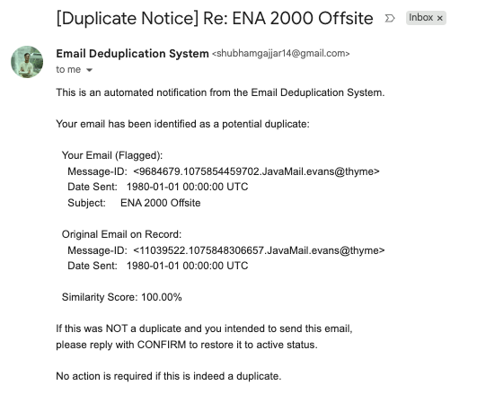
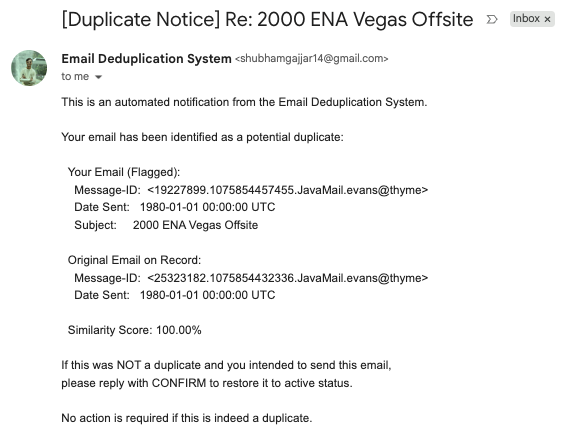
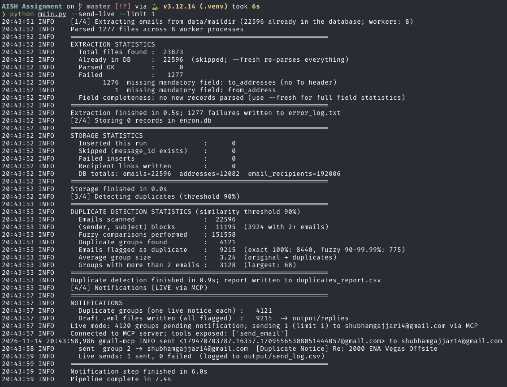

# AI Tool Usage

## 1. Tool used
- **Claude Code** v2.1.325 (CLI), model **Claude Opus 5.5** (`claude-opus-5-5`).
- Effort: medium(quick completion) <-> xhigh(plan mode)
- Claude Code features used:
  - Plan mode, to get a design approved before any code was written.
  - A project `CLAUDE.md`, holding the requirements checklist and the working agreement.
  - Structured clarifying questions, used for decisions with real trade-offs.
  - Bash tool runs, for profiling the data and verifying the code.

---

## 2. Prompting strategy

**Approach: give the full spec once, then build one task at a time, with human checkpoints.**
1. I gave the AI the whole assignment document, but asked for **requirements extraction and a dataset
   check first**, with no code. It turned the spec into a checklist in `CLAUDE.md`. That file loads into
   every session, so the requirements stay in front of the model throughout.
2. I asked for **plan mode** covering all four tasks before any code. The AI profiled the real data
   first, so the plan rests on measured facts rather than guesses. For example, 93% of duplicate groups
   share identical timestamps, and two kinds of header folding exist.
3. Implementation went **one task at a time, with a stop after each** so I could verify the code, the
   output and the numbers before moving on.
4. **Optimization came last**, after all four tasks were verified and committed. I directed two
   optimizations, parallel parsing and incremental re-runs, to increase throughput and reduce run time
   (prompt 4).

### Example prompts

| # | Prompt (lightly edited) | Why it was structured this way |
|---|---|---|
| 1 | "Read the assignment document, extract the relevant information, and check whether the dataset is properly there. Look for rules like .py or .ipynb requirements. Make a CLAUDE.md. There are 4 tasks. Follow them in order, stopping at each one so I can verify the task, code and performance. Once all tasks are finished we focus on optimizing, but first I need a working prototype. Explain the decisions you take: when there are multiple paths, why you chose one and its pros & cons." | Front-loads the full context but **forbids coding**. Requirements and data checks come first, so the AI finds ambiguities and data problems (for example, 1,239 emails with no `To:` header) before they turn into bugs. The checkpoint rule stops it from producing one unreviewable block of code. |
| 2 | "Now start plan mode for tasks 1, 2, 3 and 4. First I read the plan, then focus on execution." | Plan mode separates design from execution. The AI profiled the dataset during planning and asked targeted questions (MCP server choice, live-send volume) instead of assuming answers. |
| 3 | "Use the gmail MCP server's send_email tool to send me the duplicate notice in `output/replies/g0002_latest_….eml`. Use the file's Subject, body and References header exactly, send it to `<my address>`, and set original_recipient to the file's To address." | Names the **server and tool explicitly**, points to the exact draft so nothing is invented, and requires exact headers and body. It also gives the redirect rule (my inbox, with the original sender kept in `X-Original-To`). See §6.3. |
| 4 | "Implement parallel email parsing to increase throughput and reduce run time, and on re-runs skip the files already stored in the database." | States the **goal** (more throughput, less run time) along with the change, and limits the scope to exactly two optimizations, so nothing else in the already-verified pipeline is touched. The results were then checked against the committed outputs: identical database, report and error log, with extraction going from about 5.3 s to 1.0 s (README §5). |

---

## 3. Iterations & debugging
Because I required a verification checkpoint after every task before approving a commit, Claude Code had to run validation checks at each stage, including random sampling, independent row counts, a clean Python 3.10 virtual environment test, and offline failure tests. None of these bugs required manual code edits on my part; when a verification step caught an issue, Claude Code diagnosed the root cause and fixed it before we moved on to the next task.

### 3.1 compat32 returns `Header` objects for 8-bit headers (Task 1)
- **What went wrong:** The AI's first data-profiling script crashed with `TypeError: argument of type 'Header' is not iterable`.
- **Root cause:** Under the lenient `compat32` policy, Python's `email` package returns an `email.header.Header` object instead of a `str` when a header contains raw non-ASCII bytes. This happened in one specific file (`kitchen-l/_americas/regulatory/113.`).
- **Fix:** Claude Code updated the parser to pass every header through `decode_header()`, which accepts both `str` and `Header` objects, and decode each chunk using a fallback chain (`declared charset -> UTF-8 -> cp1252 -> latin-1`). The address `rené.lazure@enron.com` now parses cleanly.

### 3.2 The headings heuristic produced false positives (Task 1)
- **What went wrong:** On the first version, random sampling showed salutations (`Dave:`, `Jim:`), table
  rows (`TOTAL 2001 MEXICO CITY\t $954,929`) and newswire timestamps
  (`00:20AM EST 12-DEC-00 MERRILL LYNCH …`) being reported as headings.
- **Fix:**
  - A one-word `Label:` only counts as a heading if it's a known section word (Agenda, Summary, …).
  - `Dear…`/`Hi…` salutations are excluded.
  - Lines with tabs, `$`, or more than 20% digits are rejected as data rows.
  - ALL-CAPS headings must start with a letter.
- **Result:** Heading coverage fell from 22.61% to 16.16% of emails, and the samples now show mostly real
  section titles.

### 3.3 Exact dependency pins broke the "Python 3.10+" requirement (Task 1)
- **What went wrong:** The AI pinned the versions installed under Python 3.12 (`rapidfuzz==3.14.6`). A
  fresh Python 3.10.20 environment then failed:
  `No matching distribution found for rapidfuzz==3.14.6 (Requires-Python >=3.11)`.
- **Fix:** `requirements.txt` now uses compatible ranges (`rapidfuzz>=3.9,<4`, `python-dateutil>=2.9`,
  `mcp>=2.0,<3`).
- **Verification:** The extraction produces **identical parse results and error logs** (ignoring the
  timestamp column) on Python 3.10.20 and 3.12.14.

### 3.4 Profiling miscounted CRLF files; the parser was right (Task 1)
- **What went wrong:** Early profiling predicted 1,239 emails without a `To:` header, but the parser
  reported 1,276.
- **Root cause:** The profiling script found the end of the header block by splitting on `\n\n`. That
  misses 37 files with CRLF line endings, so their bodies were scanned as headers and their forwarded
  `To:` lines were counted. The parser, which follows RFC 5322, was correct.
- **Lesson:** Check AI-generated numbers against a second, independent method.

### 3.5 The MCP server's error messages disappeared (Task 4)
- **What went wrong:** The AI's first version of `send_email` raised `ValueError` for configuration
  problems. A test run with missing credentials logged only
  `Error executing tool send_email` in `send_log.csv`, so the real reason was lost.
- **Root cause:** MCP Python SDK v2 treats any ordinary exception from a tool as a crash. The message
  stays on the server, and the client gets a generic text. Only `ToolError` passes its message to the
  client. This turned up by reading the SDK source (`mcp/server/mcpserver/tools/base.py`).
- **Fix:** Expected failures now raise `ToolError` with a specific reason: missing credentials, a
  recipient not on the allowlist, a Gmail login rejection, or an SMTP/network error.
- **Verification:** Three offline tests (no credentials, recipient not on the allowlist, and SMTP pointed
  at a closed port) each log their exact cause, and the DB notification state is unchanged.

---

## 4. What I wrote vs. what the AI wrote

**Rough split: ~90% AI execution (code & verification) / ~10% human direction, architecture approval, and setup.**
- **AI's role (Implementation, profiling & testing):** Claude Code wrote all ~1,570 committed lines of Python and SQL across `main.py`, `pipeline/`, `mcp_server/`, `schema.sql`, and `sample_queries.sql`, profiled the dataset, proposed the normalization/tie-breaking rules in Plan Mode, and executed the verification checks.
- **My role (Workflow design, checkpoint review, and environment setup):** I set up the phased workflow (requiring Plan Mode before coding and mandatory stops after each task), reviewed and approved the design choices and verification results before each git commit, directed the post-prototype performance optimizations (parallel parsing and incremental re-runs), handled the dataset and Gmail/MCP credential setup outside the AI session, and edited the final documentation.

| Area | Written by | Details |
|---|---|---|
| `main.py`, `pipeline/`, `mcp_server/`, `schema.sql`, `sample_queries.sql`, `requirements.txt` | AI | Generated task by task after I approved the plan. |
| Requirements checklist (`CLAUDE.md`), data profiling, the plan | AI | The spec became a checklist, and the dataset was measured before the design. |
| `README.md`, `AI_USAGE.md` | AI-drafted, updated by me | I decided the content and edited the prompt quotes. |
| Working method | Me | Task order, a stop after each task, plan mode before code, prototype before optimization, a commit only on my approval. |
| Decisions | Me | Custom Python MCP server instead of the archived open-source one. Live sends capped with `--limit`. All 9,215 `.eml` drafts committed, as the deliverables list requires. Each task plan approved. |
| Dataset | Me | Downloaded the CMU dataset and selected the five mailboxes. |
| Review | Me | Checked each task's results before approving its commit. The AI ran the checks. |
| Gmail and MCP setup | Me | Turned on 2-Step Verification, created the App Password, and filled in `mcp_config.json` myself, so the password never entered the AI conversation. Ran `claude mcp add-json` to register the server with Claude Code, then ran the `send_email` prompt in a new session. |
| `.gitignore` | Both | The AI wrote it, and I added some additional files. |
| Performance optimizations: parallel parsing, incremental re-runs | Me (decision), AI (code) | I asked for both, to increase throughput and reduce run time. Claude Code generated the code. |
| Live-send exit code | AI recommended, I reviewed, AI implemented | `main.py` now exits with code 1 when live sending fails or is aborted. |

---

## 5. Lessons learned

### What worked well
- **Turning the spec into a checklist first.** `CLAUDE.md` kept every requirement in the model's context
  for the whole session, and each task was checked against it before it was committed.
- **Planning on measured data.** The AI profiled the dataset before designing anything. That turned up
  three facts that shaped the plan:
  - 93% of duplicate groups share an identical timestamp, so ties needed a fixed rule (break them by
    `source_file`).
  - Headers fold in two different ways.
  - 1,239 emails have no `To:` header.

  So the plan already handled what would otherwise have been mid-build surprises.
- **A checkpoint after each task.** Each task stayed small enough to review and was committed on its own.
  Problems such as the heading false positives were fixed inside the task, not discovered at the end.
- **Asking for options and trade-offs.** Each design choice came with alternatives and reasons I could
  check and defend; the MCP server is one example.
- **AI-run verification.** The AI checked its own work with concrete tests:
  - a second run inserts 0 rows;
  - rebuilding recipient lists gives 0 mismatches;
  - report rows equal flagged rows;
  - the drafts match the template text;
  - output is identical on Python 3.10.

### What was harder than expected
- **Libraries newer than the model's knowledge.** MCP SDK v2 renamed `FastMCP` to `MCPServer` and hides
  ordinary exception messages from the client (§3.5, §6.4). Both turned up only by inspecting the
  installed package. Check the installed version rather than trusting the model's memory.
- **AI numbers need a second method.** One profiling count was wrong because of CRLF line endings (§3.4).
  The parser was right, and only an independent count showed which number to trust.
- **Heuristic fields have no ground truth.** Headings and the body/forward/quote split can only be judged
  by sampling. The first version of the heading rules looked fine until random samples were read (§3.2).
- **Similar text is not always a duplicate.** At 90% character similarity, templated emails with the same
  sender and subject (for example, automated approval notices) count as duplicates. The spec sets the
  threshold, so this is documented as a limitation. The notice's CONFIRM reply and `--threshold` are the
  ways to correct it.
- **Minimum-version support.** Pinning the versions installed under Python 3.12 broke installation on
  3.10 (§3.3). Only a fresh 3.10 environment caught it.

---

## 6. MCP integration

### 6.1 Which MCP server, and why
A **custom Python MCP server** (`mcp_server/gmail_server.py`), built on the official MCP Python SDK v2
(`MCPServer`), exposing one tool, `send_email`. It sends through **Gmail SMTP with a Gmail App Password**.

| Option considered | Verdict |
|---|---|
| `GongRzhe/Gmail-MCP-Server` (Node, Gmail API + OAuth) | The best-known open-source option, but its repository was **archived in March 2026**. Setup needs a Google Cloud project, an OAuth consent screen, a test user and a credentials file (about 30–45 minutes), and it may not be able to set the custom `References:` header that the notification template needs. |
| **Custom server (chosen)** | About 100 lines, all in the project's own language (Python). It sets the template headers exactly (`Date`, `References`), and setup takes about 5 minutes (an App Password, no GCP project). An optional recipient **allowlist** (`GMAIL_ALLOWED_RECIPIENTS`) stops it from ever emailing someone other than the operator. |

**How the pipeline uses it.** `python main.py --send-live` makes the pipeline an **MCP client**. It
launches the server over stdio from `mcp_config.json`, checks that `send_email` is listed by
`list_tools`, then calls `call_tool("send_email", …)` once per notification. The same server is also
registered with Claude Code, so the AI assistant can send email through the same tool.

**Safety.** Every live notice is sent to the operator's own Gmail and never to the original Enron
senders, many of whom are real external companies. The intended recipient goes in an `X-Original-To`
header. `--limit` (default 5) keeps a run well inside Gmail's daily sending quota of about 500 messages.

### 6.2 Setup, step by step
1. **Turn on 2-Step Verification** for your Google account (required for App Passwords).
2. **Create an App Password** at <https://myaccount.google.com/apppasswords> and copy the 16 characters.
3. **Configure the server:** run `cp mcp_config.json.example mcp_config.json`, then fill in
   `GMAIL_ADDRESS`, `GMAIL_APP_PASSWORD` and `GMAIL_ALLOWED_RECIPIENTS` (your own address).
   `mcp_config.json` is gitignored and never committed.
4. **Send from the pipeline:** run `python main.py --send-live --limit 1`.
5. **Register the server with Claude Code** (local scope, so credentials stay in your user config and out
   of the repo):
   ```bash
   claude mcp add gmail --scope local \
     -e GMAIL_ADDRESS=you@gmail.com -e GMAIL_APP_PASSWORD='xxxx xxxx xxxx xxxx' \
     -e GMAIL_ALLOWED_RECIPIENTS=you@gmail.com \
     -- "$PWD/.venv/bin/python" "$PWD/mcp_server/gmail_server.py"
   claude mcp list        # gmail: ... - ✓ Connected
   ```
   Then start a new Claude Code session, where `/mcp` lists `gmail` with the `send_email` tool.

### 6.3 How the AI tool was prompted to use `send_email`
The `send_email` tool is used in two ways:

**a) From the pipeline (automated).** `python main.py --send-live --limit 1` makes the pipeline call the
tool for each group's latest duplicate. No prompting is involved; this is the reproducible path the spec
requires.

**b) From Claude Code (interactive).** I registered the server with Claude Code (`claude mcp add-json -s
local gmail …`, built from `mcp_config.json`; `claude mcp list` showed `gmail ✓ Connected`). In a new
session I sent this prompt:

> Use the gmail MCP server's send_email tool to send me the duplicate notice in
> `output/replies/g0002_latest_19227899.1075854457455.JavaMail.evans_thyme.eml`. Use the file's Subject,
> body and References header exactly, send it to `<my Gmail>`, and set original_recipient to the file's
> To address.

Claude Code read the draft, called `gmail` → `send_email` once, and reported:

```
Subject:        [Duplicate Notice] Re: 2000 ENA Vegas Offsite
References:     <19227899.1075854457455.JavaMail.evans@thyme>
X-Original-To:  kay.chapman@enron.com   (the file's To: address)
Body:           the file's body, word for word
Message-ID:     <179468551110.13604.8733311295844959285@gmail.com>   (returned by the server)
Sent at:        Sat, 14 Nov 2026 19:45:11 +0000
```

**Why the prompt is written this way:**
- It names the server and the tool, so the model doesn't improvise another way to send.
- It points at an existing draft, so the content comes from the pipeline and isn't invented by the AI.
- It requires exact headers, so the `References` threading header is kept.
- It sets `original_recipient`, so the redirect stays traceable.

Without being asked, Claude Code also pointed out that both dates in this notice show
`1980-01-01 00:00:00 UTC`. These are among the 23 source emails stamped `1979-12-31 16:00 -0800`, a quirk
of the data that is documented in the README.

### 6.4 Issues encountered and how they were resolved
1. **The SDK API changed between major versions.** The plan assumed `from mcp.server.fastmcp import
   FastMCP` (SDK v1). The installed SDK, v2.3.0, raised `No module named 'mcp.server.fastmcp' … FastMCP was
   renamed to MCPServer`. Inspecting the installed package before writing the server caught this, and the
   code uses `from mcp.server.mcpserver import MCPServer`. The client result field also changed from
   `isError` to `is_error`.
2. **Tool error messages were hidden.** See §3.5. SDK v2 replaces ordinary exceptions with a generic
   message, so the fix was to raise `ToolError`.
3. **stdout is reserved for the protocol.** With the stdio transport, anything printed to stdout corrupts
   the JSON-RPC stream, so the server logs only to stderr.
4. **The first live send failed with `SMTPServerDisconnected`.** The first attempt (19:02:34 UTC, kept in
   `send_log.csv`) failed with `Connection unexpectedly closed`. The cause was the configuration:
   `GMAIL_ADDRESS` named a different account from the one that issued the App Password. Gmail drops the
   connection in that case instead of returning a clear login error.
   - **Fix:** set `GMAIL_ADDRESS` and `GMAIL_ALLOWED_RECIPIENTS` to the account that owns the App
     Password. The next send succeeded.
   - **Prevention:** the server now adds that hint to `SMTPServerDisconnected` errors.

### 6.5 Evidence of a successful live send
**`output/send_log.csv`** (complete, from the live runs):
```
timestamp,recipient,subject,status,error
2026-11-14T19:02:34Z,implici71@gmail.com,[Duplicate Notice] Re: ENA 2000 Offsite,failed,Error executing tool send_email: SMTP delivery failed: SMTPServerDisconnected: Connection unexpectedly closed
2026-11-14T19:06:12Z,shubhamgajjar14@gmail.com,[Duplicate Notice] Re: ENA 2000 Offsite,sent,
2026-11-15T01:43:57Z,shubhamgajjar14@gmail.com,[Duplicate Notice] Re: 2000 ENA Vegas Offsite,sent,
```

**The database state after the sends.** The latest duplicates of groups 1 and 2 are marked notified, and
their intended recipients were redirected to my inbox:
```
message_id                                     intended_recipient        notification_sent  notification_date
<9684679.1075854459702.JavaMail.evans@thyme>   david.delainey@enron.com  1                  2026-11-14 19:06:12
<19227899.1075854457455.JavaMail.evans@thyme>  kay.chapman@enron.com     1                  2026-11-15 01:43:57
```

**Claude Code send:** server-returned Message-ID `<179468551110.13604.8733311295844959285@gmail.com>`
at `2026-11-14 19:45:11 UTC` (see §6.3).

Gmail's SMTP server accepted every send with status `sent`. The screenshots show two of the notices in the
Gmail inbox:

| Pipeline send (group 1) | Claude Code send (group 2) |
|---|---|
|  |  |

**Terminal output of the third send.** The optimized pipeline skipped the 22,596 stored files, used 8
worker processes, and sent one notice through the MCP server (server Message-ID
`<179470703787.16357.17095565308051444057@gmail.com>`):


